  

  

## About

I build web apps that turn public city data into pages anyone can read: where the traffic is jammed,
where it is flooding, how the air is, and what a piece of land is worth.

> ทำเว็บที่เอาข้อมูลเมืองมาเล่าเป็นภาษาไทยง่าย ๆ ให้ทุกคนใช้ได้

## Projects

  

  

  
   
  

## Tools I use

  

