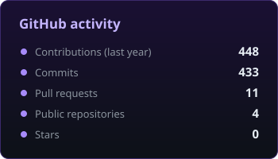
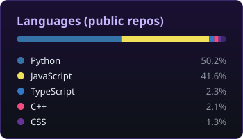

  

  

  
  

## About

I build web apps that turn public city data into pages anyone can read: where the traffic is jammed,
where it is flooding, how the air is, and what a piece of land is worth.

> ทำเว็บที่เอาข้อมูลเมืองมาเล่าเป็นภาษาไทยง่าย ๆ ให้ทุกคนใช้ได้

## Projects

<table>
  <tr>
    <td width="50%" valign="top">
      <h3><a href="https://github.com/Madaka17/new_ccty_bangkok">BKK StreetSmart</a></h3>
      Live traffic, floods, air quality and AI cameras for Bangkok and the nearby provinces, on one site in plain Thai.
      YOLO counts vehicles and spots riders without helmets and wrong-way drivers.
        
      <a href="https://bkksmartstreet.com"><b>bkksmartstreet.com</b></a>
        
      
    </td>
    <td width="50%" valign="top">
      <h3><a href="https://github.com/Madaka17/web-app2">OpenPlot</a></h3>
      A map of Bangkok and the ring provinces with resale listings and new projects.
      Click a pin or an empty spot to get an asking-price estimate from a CatBoost + LightGBM + XGBoost model.
        
      <a href="https://github.com/Madaka17/Prediction">Prediction</a>: the first prototype of the same app.
        
      
    </td>
  </tr>
</table>

## Tools I use

  

## Activity

  
  

  

The activity cards are redrawn every day by a GitHub Action in this repository.
